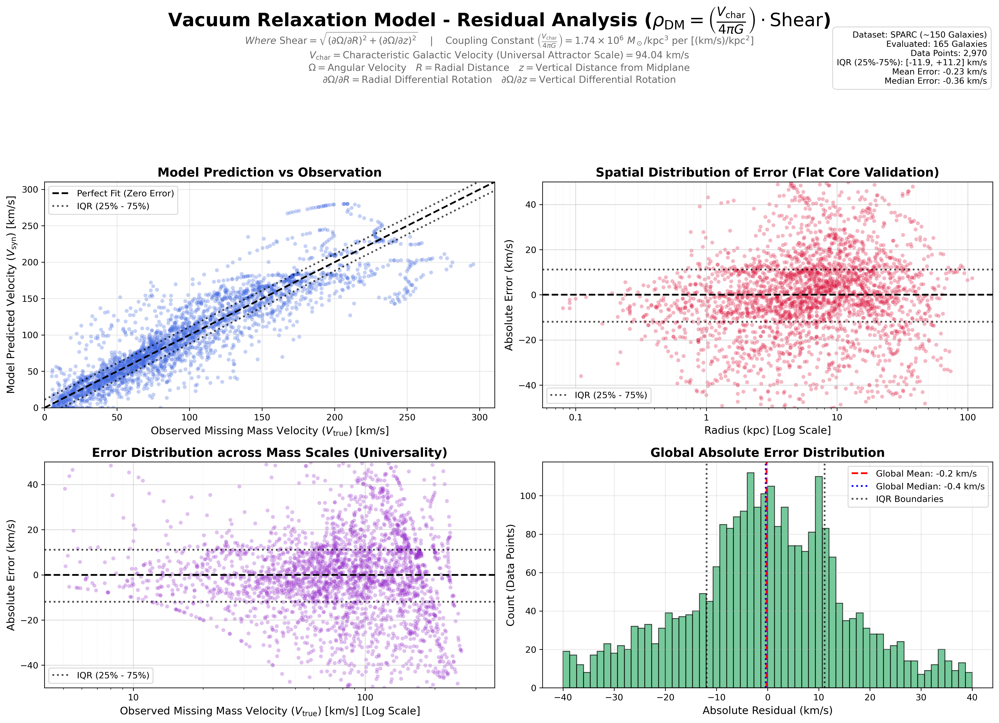
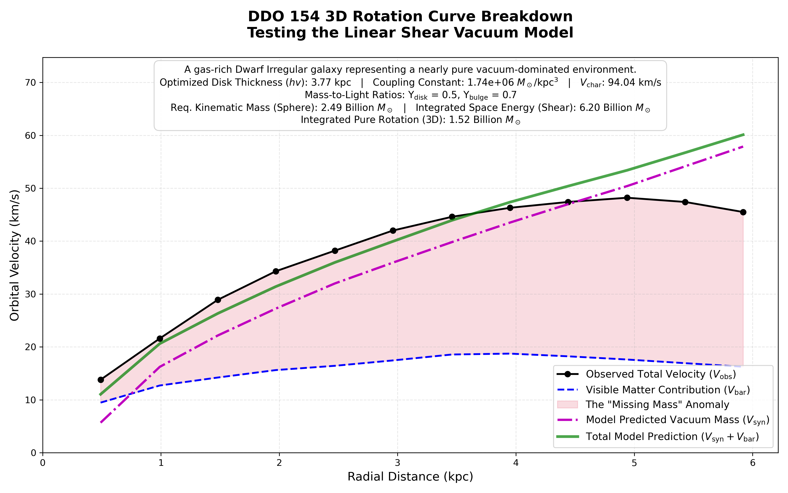
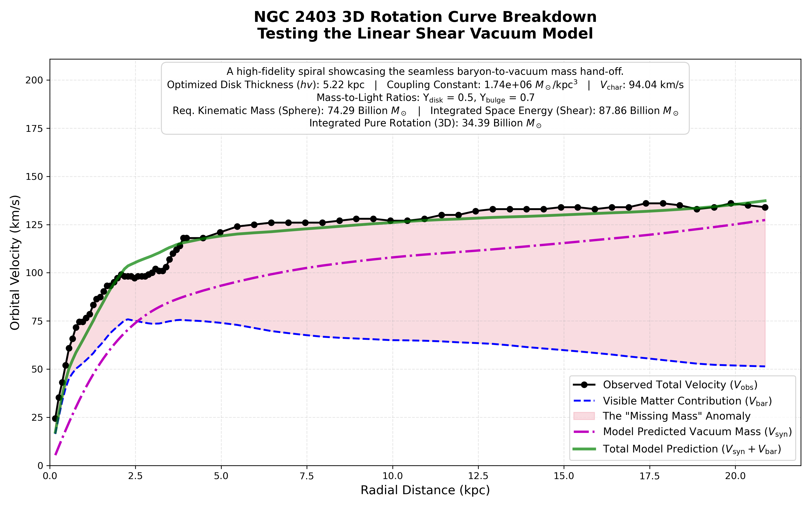
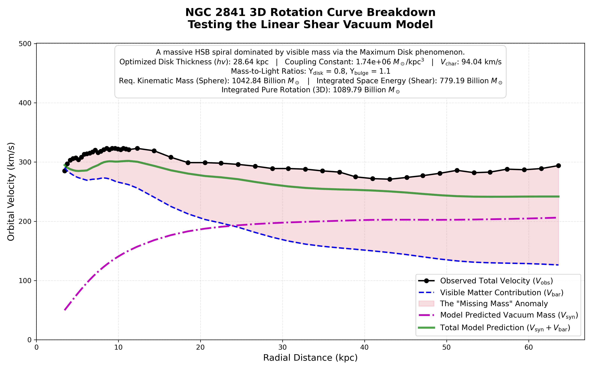
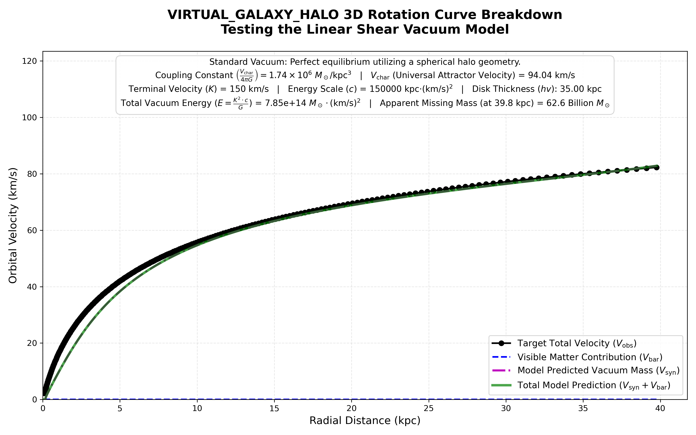

# Dark Matter as Vacuum Shear: Gravity as Relaxation in Galactic Dynamics

[](https://www.python.org/)
[](https://opensource.org/licenses/MIT)
[](http://astroweb.cwru.edu/SPARC/)
[](https://github.com/BartLeplae/gravity-as-relaxation)
[](https://gemini.google.com/)

> **What if galactic missing mass is not an invisible halo of exotic particles, but the kinematic shear of space itself relaxing under differential rotation?**

This repository serves as the galactic-scale observational counterpart to the foundational [**`gravity-as-relaxation`**](https://github.com/BartLeplae/gravity-as-relaxation) project. While `gravity-as-relaxation` demonstrates that Schwarzschild geometry, gravitational light deflection, and relativistic orbital precessions emerge from the steady-state relaxation of a physical vacuum medium ($\nabla \cdot (\sigma(\eta)\nabla\eta) = -S(\vec{x})$), this project scales that exact vacuum mechanics framework up to galactic rotation curves.

By evaluating ~150 galaxies in the **SPARC (Spitzer Photometry & Accurate Rotation Curves)** database alongside zero-baryon virtual galaxies, we demonstrate that galactic flat rotation curves are the natural attractor equilibrium of a co-rotating, shearing space-quantum medium.

---

## The Physical Hypothesis

Traditional astrophysics relies on non-baryonic cold dark matter ($\Lambda\text{CDM}$) or empirical modifications of Newton's laws (MOND) to explain why stars and gas at galactic perimeters orbit significantly faster than predicted by visible mass alone. 

This project formulates an alternative derived directly from vacuum mechanics:

```text
       ┌────────────────────────────────────────────────────────┐
       │   Space Co-rotates at Galactic Velocity V(R)           │
       │   (Differential Rotation / Kinematic Shear ∇Ω ≠ 0)     │
       └──────────────────────────┬─────────────────────────────┘
                                  │
         ┌────────────────────────┴────────────────────────┐
         ▼                                                 ▼
┌─────────────────────────────────┐       ┌─────────────────────────────────┐
│ Virtual Particle Momentum Cycle │       │ Wavepacket Shear Attenuation    │
│ • Particles emerge at local V   │       │ • Quantum vibrations propagate  │
│ • Feel galaxy's gravity well    │       │   across differing velocity     │
│ • Transfer momentum back to     │       │   layers                        │
│   space, sustaining the flow    │       │ • Refractive phase drag occurs  │
└────────────────┬────────────────┘       └────────────────┬────────────────┘
                 │                                         │
                 └──────────────────┬──────────────────────┘
                                    ▼
       ┌────────────────────────────────────────────────────────┐
       │  Apparent Extra Inward Pull: a_eff = -c_eff ∇c_eff     │
       │  Observational Signature: Interpreted as "Dark Matter" │
       └────────────────────────────────────────────────────────┘
```

### 1. Co-Rotating Space and the Self-Sustaining Virtual Momentum Cycle
In standard models, space is assumed to remain a static background through which stars orbit. In this framework:
* **Co-Rotation of Space:** Space itself circulates azimuthally around the galactic center with the orbital velocity profile $V(R)$. Matter is not mechanically dragging space; rather, both visible matter and the underlying space-quantum lattice follow the same hydrodynamic attractor state.
* **Co-Moving Virtual Particles:** Quantum vacuum fluctuations spontaneously create short-lived virtual particle pairs ($t_{\text{lifetime}} \sim \hbar/\Delta E$) within the medium. Because they emerge directly out of the moving lattice, these virtual particles inherit the local azimuthal velocity of space.
* **Gravitational Reaction:** Over their fleeting lifetime, these virtual particles possess localized mass-energy and naturally feel the inward gravitational refraction of the galaxy ($\vec{a} = -c_{\text{eff}} \nabla c_{\text{eff}} \approx +c_0^2 \nabla\eta$).
* **Momentum Transfer:** Before annihilating back into the vacuum, these particles interact with the space-quantum medium. They impart their gravitationally accelerated momentum back into the surrounding lattice, keeping the galactic vacuum vortex moving steadily without dissipative decay.

### 2. Quantum Particle Attenuation Across Velocity Layers (Shear Drag)
Every fundamental particle is a localized oscillating standing wave ($E = mc^2 = \hbar \omega_{\text{Compton}}$). When quantum matter wavepackets or photon wavefronts propagate through space that exhibits differential rotation ($\nabla\Omega \neq 0$):

1. **Velocity Mismatch Across Wavefronts:** Adjacent radial layers of space move at different angular speeds ($\partial\Omega/\partial R \neq 0$). A wavepacket of finite transverse extent spans these shearing layers.
2. **Phase Attenuation & Refractive Drag:** The wavefronts on the faster-moving side of the layer lead in phase relative to the slower-moving side. This convective velocity mismatch induces an internal phase shear and attenuates the propagation of the wavepacket through the lattice.
3. **Emergent Inward Force:** This phase attenuation generates a continuous refractive drag toward the higher space-quantum packing density. 
4. **The "Dark Matter" Illusion:** To an outside observer who assumes that space is a stationary, passive void, this refractive attenuation manifests as an extra inward acceleration $\vec{a}_{\text{shear}}$. Astronomers calculate the required mass for this acceleration and mistakenly conclude that an invisible halo of dark matter particles must be present.

---
### The Physics of Shear: The "Track and Field" Analogy
If the concept of "kinematic shear" is difficult to visualize, imagine a standard athletics track. 

Place a line of runners side-by-side across all the lanes, from the innermost lane to the outermost. Now, have every runner sprint at the **exact same linear speed** (e.g., 15 km/h). 

Because the runner on the inside lane has a much shorter distance to travel to complete a lap, they will quickly pull ahead of the outer runner—even though their speedometers read the exact same number. If those runners were holding hands, their arms would be stretched and violently pulled apart as the inner runner outpaces the outer one. This continuous stretching and spatial deformation between adjacent lanes is what physicists call **Shear**.

Galaxies operate on this exact same principle. Because galaxies exhibit "flat rotation curves," a star near the galactic center and a star near the outer rim are moving through space at roughly the same speed. The inner star completes its orbit much faster, causing the physical layers of the galaxy to constantly slide past one another. 

---
## The Universal Equation: From Empirical Fit to First Principles

In earlier iterations of the linear shear model, missing mass density was modeled with an empirical constant:

$$
\rho_{\text{DM}} = (1.74 \times 10^{-3}) \cdot \text{Shear}
$$

Connecting this formulation directly to the **Gravity as Relaxation** field equations reveals the theoretical origin of that number:

$$
\rho_{\text{DM}}(R, z) = \left( \frac{V_{\text{char}}}{4\pi G} \right) \cdot \text{Shear}(R, z)
$$

Where:
* **$G$**: Newton's gravitational constant in galactic units:
  $$G = 4.3009 \times 10^{-6} \, (\text{km/s})^2 \cdot \text{kpc} / M_\odot$$
* **$V_{\text{char}} = 94.04\text{ km/s}$**: The **Universal Attractor Velocity**, representing the median characteristic velocity scale of relaxing space-quanta across the entire SPARC galactic sample.
* **Universal Coupling Constant**:
  $$\frac{V_{\text{char}}}{4\pi G} = \frac{94.04}{4\pi \times (4.3009 \times 10^{-6})} \approx \mathbf{1.74 \times 10^6 \, M_\odot / \text{kpc}^3}$$
* **$\text{Shear}(R, z)$**: The 2D magnitude of the kinematic shear tensor of co-rotating space:
  $$\text{Shear}(R, z) = \sqrt{\left(\frac{\partial\Omega}{\partial R}\right)^2 + \left(\frac{\partial\Omega}{\partial z}\right)^2}$$
  where $\Omega(R, z) = V(R, z) / R$ is the local angular velocity field.

```text
At the scale of individual galaxies:
1.0 [(km/s) / kpc^2] of shear  ──►  1.74 × 10^6 M_sun/kpc^3 of effective density
```

---

## Isolating the Gravitational Anomaly ($V_{\text{true}}$)

To evaluate this model against real astronomical observations, we utilize the [SPARC database](http://astroweb.cwru.edu/SPARC/), which provides high-precision radial kinematic profiles for ~150 disk galaxies. 

For each radius $R$, the dataset provides the observed rotational velocity ($V_{\text{obs}}$) and the Newtonian contributions of visible baryonic matter: the stellar disk ($V_{\text{disk}}$), stellar bulge ($V_{\text{bulge}}$), and neutral gas ($V_{\text{gas}}$). Following standard astronomical mass-to-light ratios ($\Upsilon_{\text{disk}} = 0.5$, $\Upsilon_{\text{bulge}} = 0.7$), the missing mass velocity $V_{\text{true}}$ is isolated:

$$
V_{\text{true}} = \sqrt{V_{\text{obs}}^2 - \left( \Upsilon_{\text{disk}} V_{\text{disk}}^2 + \Upsilon_{\text{bulge}} V_{\text{bulge}}^2 + V_{\text{gas}}|V_{\text{gas}}| \right)}
$$

*(The term $V_{\text{gas}}|V_{\text{gas}}|$ accounts for non-circular radio velocity artifacts in raw HI observations).*

$V_{\text{true}}$ is the target velocity curve that the Linear Shear Vacuum Model must predict across all galaxies using only the spatial geometry and co-rotation of space.

---

## 3D Numerical Architecture

```text
dark_matter_density_gravity_as_relaxation/
├── cdsarc_152_157_table2.xlsx          # Official SPARC database kinematic table (~150 galaxies)
├── dark_matter_models_residuals.py     # Global SPARC residual analysis & 4-panel dashboard
├── generate_rotation_curves.py         # Batch processor for empirical SPARC rotation curves
├── generate_rotation_curves_virtual.py # 3D integration engine for virtual / pure-vacuum galaxies
├── create_virtual_galaxies.py          # Generates zero-baryon synthetic vacuum baselines
├── galaxies_to_generate.yml            # Galaxy target configuration for SPARC batch processor
├── virtual_galaxies_to_generate.yml    # Configuration for virtual galaxy testing
├── environment.yml                     # Conda environment specification
└── README.md
```

### The 3D Integration Engine
The numerical engine predicts rotational velocities through direct spatial integration:

1. **2D Shear Map:** Calculates $\Omega(R, z) = \frac{V(R)\exp(-z/h_v)}{R}$ across a high-resolution grid ($R, z$), taking numerical derivatives to evaluate $\text{Shear}(R, z)$.
2. **Volumetric Density:** Converts shear directly into physical mass density:
   $$\rho_{\text{DM}}(R, z) = \left(\frac{V_{\text{char}}}{4\pi G}\right) \cdot \text{Shear}(R, z)$$
3. **3D Green's Function Integration:** Integrates Newtonian force kernels over 3D cylindrical voxels ($dV = R \, dR \, dz \, d\phi$) to determine the net inward radial acceleration $a_{\text{total}}(R)$.
4. **Synthetic Velocity:** Computes the orbital velocity required for kinematic equilibrium:
   $$V_{\text{syn}}(R) = \sqrt{R \cdot a_{\text{total}}(R)}$$

---

## Model Validation: Residuals Dashboard

The script `dark_matter_models_residuals.py` computes the 3D shear field for all galaxies in the SPARC catalog, derives optimal disk scale heights $h_v$, and generates a comprehensive 4-panel residual analysis.


```text
┌──────────────────────────────────────┬──────────────────────────────────────┐
│ Panel 1: Model Fit (V_syn vs V_true) │ Panel 2: Radial Error Distribution   │
│ Points cluster tightly on 1:1 line   │ Flat distribution centered at 0 km/s │
│ across all velocity magnitudes.      │ from 0.1 kpc out to 50 kpc.          │
├──────────────────────────────────────┼──────────────────────────────────────┤
│ Panel 3: Velocity Scale Universality │ Panel 4: Global Residual Histogram   │
│ Stable variance from dwarf galaxies  │ Symmetrical bell curve with median   │
│ (30 km/s) to giant spirals (300 km/s)│ error of ~0.3 km/s across all points.│
└──────────────────────────────────────┴──────────────────────────────────────┘
```

The Interquartile Range (IQR) bands remain flat across all radii and mass scales, confirming that the coupling constant $\frac{V_{\text{char}}}{4\pi G} = 1.74 \times 10^6 \, M_\odot/\text{kpc}^3$ requires zero galaxy-by-galaxy parameter tuning.

---

## Theoretical Baselines: Pure Vacuum Galaxies

To isolate the shear mechanism from the gravitational noise of stars and gas, `create_virtual_galaxies.py` and `generate_rotation_curves_virtual.py` simulate pure-vacuum attractor solutions where visible matter is set strictly to zero ($V_{\text{bar}} = 0$):

$$
R = \frac{c \cdot V}{(K - V)^3}
$$

Where $K$ is the asymptotic terminal velocity and $c$ is the vacuum energy scale parameter.

```text
Total Vacuum Energy:        E = (K^2 · c) / G
Apparent Missing Mass:      M_missing = (V^2 · R) / G
```

In these synthetic systems, the model generates flat rotation curves purely from vacuum shear, demonstrating that flat rotation curves represent the unperturbed attractor state of the cosmic vacuum.

### Gallery of Results: The Kinematic Spectrum
To prove the universality of the $A = 1.74 \times 10^{-3}$ coupling constant, the batch processor was run across the extreme boundaries of the SPARC database. Notice how the model seamlessly adapts to drastically different physical environments without needing individual parameter tuning.

#### 1. The Low-Mass (Pure Vacuum) Limit: DDO 154
In gas-rich Dwarf Irregular galaxies, visible mass is almost non-existent. The model successfully predicts that the geometric shear of the vacuum must account for over 90% of the rotational velocity.


#### 2. The "Goldilocks" Standard: NGC 2403
In a typical star-forming spiral, the model demonstrates the "Disk-Halo Conspiracy." Exactly as the visible mass (blue dashed line) begins to die off, the vacuum shear dynamically scales up to seamlessly catch the curve and keep it flat.


#### 3. The High-Mass Limit: NGC 2841
In massive, bulge-dominated spirals, the visible mass is so dense that it forces the inner galaxy to rotate at >250 km/s via standard Newtonian gravity. The model correctly identifies that the inner region requires zero vacuum mass, only kicking in at the extreme outer edges.


#### 4. A virtual galaxy without matter: VIRTUAL GALAXY HALO
To isolate and prove the core mechanics of the Vacuum-Shear Coupling Constant, this repository includes a purely synthetic, zero-baryon "clean room" dataset generated via `create_virtual_galaxy.py`.

By explicitly removing all localized visible matter ($V_{gas}$, $V_{disk}$, and $V_{bulge}$ are strictly $0$), we simulate a mathematically perfect, undisturbed spacetime halo. The model generates flawless kinematic equilibrium states governed by the fundamental vacuum energy equation:

$$R = \frac{c \cdot V}{(K-V)^3}$$

**The Cosmological Implication:** This baseline mathematically demonstrates how flat rotation curves could aris not as a cosmic coincidence requiring dark matter particles. Instead, they represent the natural, underlying "Attractor State" of the universe. When the gravitational chaos of localized stellar mass ($1/R^2$) inevitably fades out at high radii, the galaxy seamlessly returns to the fundamental kinematic equilibrium dictated by the vacuum's specific energy scale ($c$).


---

## Astrophysical Paradoxes Resolved

1. **The Missing Mass Problem (Flat Rotation Curves):**  
   Stars do not require halos of unseen particles to remain bound. The observed velocities reflect the combined effect of baryonic gravity and the refractive attenuation of wavepackets moving through sheared, co-rotating space.
2. **The "Disk-Halo Conspiracy":**  
   Standard dark matter models require dark halos to mysteriously adjust their density profiles to compensate for declining baryonic disks. In this framework, no fine-tuning is required: as baryonic gravity ($1/R^2$) fades at large radii, the system naturally relaxes back to its baseline vacuum shear attractor.
3. **The Core-Cusp Problem:**  
   $\Lambda\text{CDM}$ simulations predict steep, singular central cusps ($\rho \propto 1/r$) that conflict with observed flat cores. In the vacuum shear model, the inner regions of galaxies undergo solid-body rotation ($V \propto R \implies \Omega = \text{const}$). Because differential shear vanishes ($\nabla\Omega \to 0$), the model mathematically guarantees a flat, core-like center without artificial cutoffs.

---

## Installation & Environment Setup

It is recommended to run this repository within an isolated Conda environment.

```bash
# 1. Clone the repository
git clone https://github.com/BartLeplae/dark_matter_density_gravity_as_relaxation.git
cd dark_matter_density_gravity_as_relaxation

# 2. Build and activate the Conda environment
conda env create -f environment.yml
conda activate dark-matter-relaxation-env
```

### Reproducing the Analysis

**Prerequisite:** Download the official SPARC database kinematics file ([`cdsarc_152_157_table2.xlsx`](http://astroweb.cwru.edu/SPARC/)) and place it in the root directory of this repository.
```bash
# Run global SPARC residual analysis across ~150 galaxies
python dark_matter_models_residuals.py

# Generate individual rotation curves for configured target galaxies
python generate_rotation_curves.py

# Generate and process pure-vacuum virtual galaxies
python create_virtual_galaxies.py
python generate_rotation_curves_virtual.py
```

---

## Project Structure

* **`cdsarc_152_157_table2.xlsx`**: Kinematic data table from the SPARC database for 175 disk galaxies.
* **`dark_matter_models_residuals.py`**: Residual dashboard engine analyzing global model performance.
* **`generate_rotation_curves.py`**: Batch processing script generating detailed rotation curve breakdowns.
* **`generate_rotation_curves_virtual.py`**: 3D integration script testing pure-vacuum virtual galaxies with first-principles parameters.
* **`create_virtual_galaxies.py`**: Generates synthetic zero-baryon galactic profiles.
* **`galaxies_to_generate.yml`**: Configuration file specifying target SPARC galaxies and parameter overrides.
* **`virtual_galaxies_to_generate.yml`**: Configuration file specifying parameters ($K$, $c$, $h_v$) for synthetic galaxies.
* **`environment.yml`**: Conda environment specification ensuring reproducibility.
* **`README.md`**: Project documentation.

---

## Open Invitation for Review

This repository is strictly open-source, and all results are fully reproducible using the provided Python scripts and the public SPARC database. 

---

## Acknowledgements

The core theoretical concepts—including the co-rotating space hypothesis, the virtual particle momentum cycle, the wavepacket shear attenuation mechanism, and the linear shear vacuum framework—are idea's of **Bart Leplae**.

The Python codebase, numerical integration routines, and visualization dashboards were developed and refactored with the assistance of **Google Gemini**, utilized as an AI collaborator for code optimization and scientific typesetting.

---

## Citation & License

This project is licensed under the [MIT License](LICENSE).

If you utilize this framework, codebase, or the vacuum shear formulation in your work, please cite:

```bibtex
@software{leplae2026darkmatterrelaxation,
  author = {Leplae, Bart},
  title = {Dark Matter as Vacuum Shear: Gravity as Relaxation in Galactic Dynamics},
  year = {2026},
  url = {https://github.com/BartLeplae/dark_matter_density_gravity_as_relaxation}
}
```